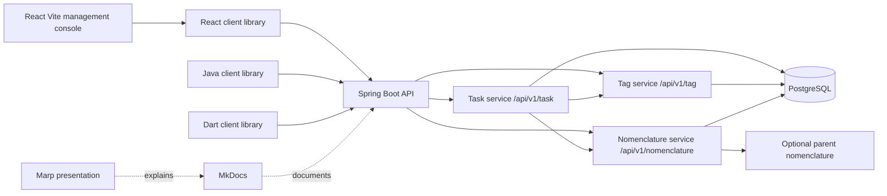

# Architecture

The repository implements task management and two reusable taxonomy domains. HTTP controllers validate transport requests and delegate business operations to services; repositories isolate Spring Data JPA access. The Java, TypeScript, and Dart clients depend on the public HTTP contract, not on persistence classes. The application namespace stays `fr.tiogars.domaintemplate`; it is not the business-domain name.

## Public Object and Persistence Entity

`Task` is the public business object returned by controllers and represented by each client. It carries identity (`id`, immutable `code`), `label`, nullable `description`, status, priority, nullable due date and assignee, tag IDs, an optional nomenclature ID, and server-owned audit timestamps and actors.

`Tag` is a reusable flat categorization domain. `Nomenclature` is a reusable hierarchical classification domain with an optional `parentId`. Both have generated identity, immutable code, mutable label and description, and the same server-owned audit fields as tasks. A task can reference many tags and one nomenclature without embedding their mutable definitions.

Internal mutable JPA entities handle persistence concerns such as generated identity, column constraints, and dirty tracking. Controllers never expose JPA entities.

The service maps between these types. This boundary keeps the public contract stable when persistence details change and prevents JPA behavior from leaking into client code.

## Invariants and Ownership

| Concern | Owner | Behavior |
| --- | --- | --- |
| Persistent identity | Server and database | `id` is a generated `Long`. |
| Business identity | Service and database | `code` is required, unique, and immutable. |
| Mutable task data | Client request | Required `label`; nullable description, due date, assignee, and nomenclature; tags default to `[]`. |
| Workflow defaults | Service | Status defaults to `TODO`; priority defaults to `NORMAL`. |
| Taxonomy integrity | Service and database | Referenced IDs must exist; nomenclature parents cannot form cycles; referenced taxonomy deletion is rejected. |
| Audit metadata | Server auditing | Dates are `Instant` values; actors are authenticated username snapshots. |
| Bulk reconciliation | Service | Seed and import upsert by `code` and ignore imported IDs and dates. |

## Schema Evolution

Apply `java/api/src/main/resources/db/manual/task-domains.sql` before starting this version, including on an existing demo database. See the [migration instructions](api.md#persistence-auditing-and-required-migration). The older `domain-template-auditing-soft-delete.sql` script documents the legacy domain's auditing migration.

Hibernate is configured with `spring.jpa.hibernate.ddl-auto: update` for this runnable application. It does not migrate legacy business data or remove unmapped tables; existing volumes may retain `domain_templates` or `domain_records`.

This convenience setting is not a migration strategy for production. Use versioned database migrations in a real service. For the demo, reset the Compose volume when a clean schema is required, as described in the [deployment guide](deployment.md#reset-the-demo-database).